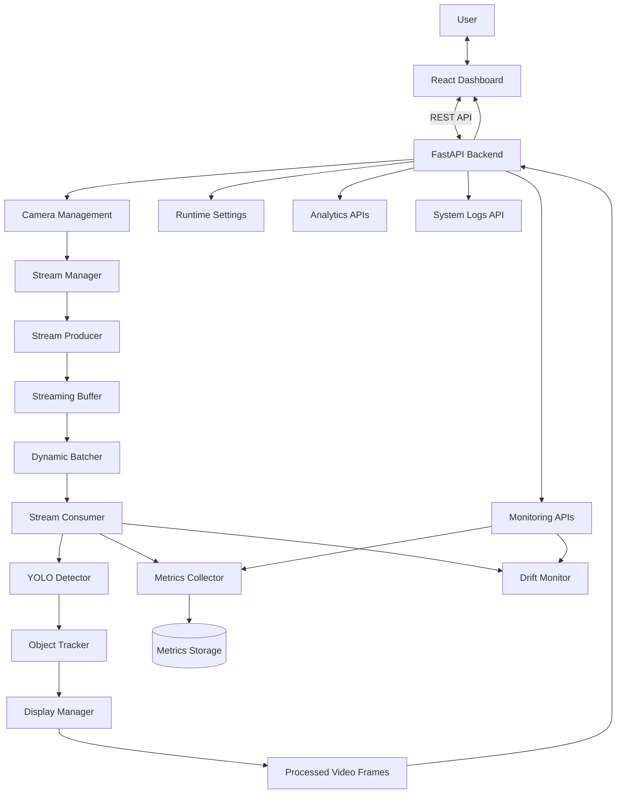

# VisionCore

### Real-Time Multi-Camera Computer Vision & Monitoring Platform

VisionCore is a real-time computer vision platform designed to process video streams, detect objects, track their movement, and monitor inference performance across multiple camera sources.

Built with a modular Python backend and an interactive React dashboard, VisionCore combines YOLO-based object detection, multi-camera stream processing, dynamic batching, object tracking, and runtime monitoring into a unified system.

The platform provides a centralized interface for managing camera streams, visualizing detection results, monitoring system performance, and analyzing operational activity.

---

## Overview

VisionCore goes beyond running object detection on individual images or videos by providing a complete video-processing and monitoring pipeline.

The backend manages incoming camera streams, processes video frames, executes model inference, tracks detected objects, and exposes real-time information through REST APIs and video streaming endpoints.

The frontend communicates with the backend and provides an interface for monitoring the system and managing its runtime configuration.

The system includes:

- **Multi-Camera Management:** Register, manage, and monitor multiple video sources.
- **Real-Time Object Detection:** Detect objects in video frames using a pretrained YOLO11s model.
- **Object Tracking:** Maintain object identities across consecutive frames.
- **Dynamic Batching:** Group frames into batches to improve inference throughput.
- **Stream Processing:** Process video streams through dedicated producer and consumer components.
- **Runtime Configuration:** Update supported inference and monitoring settings through the dashboard.
- **Drift Monitoring:** Monitor changes in incoming data using configurable monitoring windows.
- **Performance Monitoring:** Collect inference and system performance metrics.
- **Analytics Dashboard:** Visualize detection activity and system analytics.
- **System Logging:** Access application logs and operational events.

---

## Application Experience

VisionCore provides a web-based dashboard for interacting with the computer vision platform.

The frontend communicates with the FastAPI backend through REST API requests. The backend manages camera streams, inference, tracking, runtime settings, and monitoring operations.

### Frontend Workflow

The typical system workflow is:

1. **Camera Registration:** Add a camera using its video source URL.
2. **Stream Initialization:** The backend initializes the corresponding video stream.
3. **Frame Acquisition:** A stream producer reads frames from the video source.
4. **Frame Buffering:** Frames are passed through the streaming buffer.
5. **Dynamic Batching:** Available frames are grouped into batches according to the configured batch size and waiting time.
6. **Model Inference:** The YOLO detector processes the frames and returns object detections.
7. **Object Tracking:** The tracking component associates detections across consecutive frames.
8. **Frame Annotation:** Detection boxes and tracking information are rendered on the processed frames.
9. **Monitoring and Analytics:** The backend collects relevant metrics and monitoring information.
10. **Dashboard Visualization:** The frontend displays camera streams, detections, system metrics, analytics, and logs.

### Frontend Capabilities

- Manage camera sources.
- View processed video streams.
- Monitor object detection results.
- Access analytics and performance information.
- Review system logs.
- Update supported runtime settings.
- Monitor camera and processing status.

---

## Frontend Preview

VisionCore includes an interactive dashboard for managing and monitoring the computer vision platform.

Explore the application screenshots below:

**Quick Navigation**

- [Dashboard](#1-dashboard)
- [Analytics](#2-analytics)
- [Settings](#3-settings)
- [System Logs](#4-system-logs)

### 1. Dashboard

The main dashboard provides an overview of the running computer vision system, including camera streams and detection activity.


### 2. Analytics

The analytics page provides visual insights into system activity and collected detection information.


### 3. Settings

The settings interface allows users to configure supported runtime parameters without manually changing application configuration files.


### 4. System Logs

The system logs page provides visibility into application events and operational activity.


*Click any screenshot to open the full-size image.*

---

## System Architecture

VisionCore follows a modular architecture that separates video acquisition, frame processing, model inference, tracking, monitoring, and API communication.

The backend is responsible for the computer vision pipeline, while the frontend provides a centralized interface for system interaction.



### Architectural Components

| Component | Responsibility |
|---|---|
| FastAPI Backend | Exposes REST APIs and coordinates system operations |
| Camera Management | Handles camera registration and lifecycle |
| Stream Manager | Coordinates camera streams and associated processing components |
| Stream Producer | Acquires frames from video sources |
| Streaming Buffer | Holds incoming frames for downstream processing |
| Dynamic Batcher | Groups frames for batched inference |
| Stream Consumer | Consumes frames and coordinates inference and processing |
| YOLO Detector | Performs object detection |
| Object Tracker | Associates detections across consecutive frames |
| Display Manager | Stores and provides annotated frames |
| Metrics Collector | Collects inference and performance metrics |
| Drift Monitor | Monitors changes in incoming data |
| React Dashboard | Provides the user-facing monitoring interface |

---

## Real-Time Video Processing Pipeline

VisionCore uses a producer-consumer architecture to separate frame acquisition from inference execution.

This separation allows the system to acquire frames while inference is being performed, rather than forcing both operations into a single sequential process.

### How It Works

1. **Frame Acquisition:** A producer continuously reads frames from the configured video source.
2. **Frame Buffering:** Incoming frames are placed into a thread-safe streaming buffer.
3. **Batch Formation:** The dynamic batcher collects available frames according to configurable batching parameters.
4. **Inference Execution:** The consumer sends the batch to the YOLO detector.
5. **Detection Processing:** The detector extracts bounding boxes, class IDs, class names, and confidence scores.
6. **Object Tracking:** The tracker associates detections across frames.
7. **Frame Annotation:** Processed frames are annotated with detection information.
8. **Stream Delivery:** The Display Manager makes the latest processed frames available to the streaming API.

### Why This Architecture?

- **Separation of Responsibilities:** Frame acquisition and inference execution are handled independently.
- **Continuous Processing:** The producer can acquire frames while the consumer processes previously acquired frames.
- **Batch Inference:** Multiple frames can be processed in a single inference call.
- **Configurable Processing:** Batch size and waiting time can be adjusted through runtime settings.
- **Reduced Backlog Risk:** The streaming pipeline is designed to avoid continuously accumulating outdated frames.

### Producer-Consumer Architecture

```mermaid
flowchart LR
    SOURCE[Video Source] --> PRODUCER[Stream Producer]

    PRODUCER --> BUFFER[Streaming Buffer]

    BUFFER --> BATCHER[Dynamic Batcher]

    BATCHER --> CONSUMER[Stream Consumer]

    CONSUMER --> DETECTOR[YOLO Inference]

    DETECTOR --> TRACKER[Object Tracking]

    TRACKER --> DISPLAY[Display Manager]

    DISPLAY --> OUTPUT[Processed Frames]
```



---

## Dynamic Batching

VisionCore uses a dynamic batching component to group incoming frames before sending them to the detection model.

Instead of processing every frame independently, the batcher collects available frames until one of its configured conditions is reached.

The batching behavior is controlled by:

- **Maximum Batch Size:** The maximum number of frames included in a batch.
- **Maximum Waiting Time:** The maximum time the batcher waits to collect additional frames.

### Why Dynamic Batching?

- **Inference Efficiency:** Process multiple frames through a single model inference call.
- **Configurable Throughput:** Adjust batch size according to the available processing resources.
- **Latency Control:** Limit how long frames wait before being processed.
- **Resource Utilization:** Provide more control over inference workload distribution.

The batching component is configurable at runtime through the settings interface.

---

## Object Detection and Tracking

### 1. YOLO-Based Object Detection

VisionCore uses **YOLO11s**, a pretrained object detection model from Ultralytics.

The model is pretrained on the COCO dataset, which contains 80 object categories.

It supports detecting multiple object types, including:

- People.
- Cars and motorcycles.
- Buses and trucks.
- Bicycles.
- Animals such as dogs, cats, horses, and birds.
- Common household objects.
- Sports equipment and other everyday objects.

The detector extracts the following information for each detection:

- Bounding box coordinates.
- Class ID.
- Class name.
- Confidence score.

The detection results are converted into a unified internal detection schema for downstream processing.

**Model Configuration:** The model weights are loaded through application configuration, allowing the model file to be changed without modifying the detection pipeline, provided the replacement model is compatible with the detector's expected task and output format.

### 2. Object Tracking

Detection alone identifies objects in individual frames. Tracking adds the ability to associate detections across consecutive frames.

VisionCore includes a tracking component that maintains object identities as they move through the video stream.

The tracking pipeline uses a Kalman-filter-based approach to estimate object positions and associate detections with existing tracks.

This allows the system to:

- Maintain object IDs across frames.
- Estimate object movement.
- Associate detections with existing tracks.
- Handle short periods where an object is not detected.

---

## Monitoring and Analytics

VisionCore includes monitoring components that provide visibility into the behavior of the video-processing pipeline.

### 1. Metrics Collection

The metrics collector periodically gathers system and inference-related performance information.

Collected information can be accessed through the backend monitoring APIs and displayed in the dashboard.

### 2. Drift Monitoring

VisionCore includes a drift-monitoring component that tracks changes in incoming data over a configurable observation window.

The monitoring component is designed to provide visibility into changes that may affect the behavior of the computer vision system.

Its configuration includes:

- **Drift Window Size:** Controls the number of observations considered by the monitoring component.
- **Monitoring Interval:** Controls how frequently monitoring is performed.

### 3. Analytics

The analytics interface provides a visual representation of collected system information and detection activity.

It helps users understand system behavior without manually inspecting backend logs or API responses.

### 4. System Logging

The logging interface provides access to application events and operational information, helping users investigate system activity and identify potential issues.

---

## Runtime Configuration

VisionCore provides an API-driven runtime settings mechanism.

Supported settings can be retrieved and updated through the backend without manually editing configuration files or restarting the application.

The settings interface includes:

| Setting | Description |
|---|---|
| Confidence Threshold | Controls the minimum confidence required for detections |
| Maximum Batch Size | Controls the maximum number of frames per inference batch |
| Maximum Waiting Time | Controls the batch collection waiting time |
| Metrics Interval | Controls how frequently metrics are collected |
| Drift Window Size | Controls the drift observation window |
| Drift Monitoring Interval | Controls the drift monitoring frequency |

The inference device is selected through application configuration. Runtime device switching is not currently supported.

---

## Technology Stack

| Component | Technology |
|---|---|
| Backend | Python, FastAPI |
| Frontend | React, TypeScript |
| Frontend Build Tool | Vite |
| Styling | Tailwind CSS |
| Data Visualization | Recharts |
| Icons | Lucide |
| Object Detection | Ultralytics YOLO11s |
| Object Detection Dataset | COCO |
| Deep Learning Framework | PyTorch |
| Computer Vision | OpenCV |
| Object Tracking | Kalman Filter |
| Concurrency | Python Threading |
| API Communication | REST API |
| Video Streaming | MJPEG |
| Metrics Storage | SQLite |
| Model Configuration | Environment Variables |
| Package Management | uv |
| API Documentation | OpenAPI / Swagger UI |

---

## Project Structure

```text
Vision-Core/
├── docs/
│   └── images/
│       ├── analytics/
│       ├── dashboard/
│       ├── settings/
│       └── system_log/
│
├── frontend/
│   ├── src/
│   ├── public/
│   ├── package.json
│   └── ...
│
├── src/
│   └── vision_core/
│       ├── analytics/
│       ├── api/
│       │   └── routes/
│       ├── core/
│       ├── detection/
│       ├── inference/
│       ├── monitoring/
│       ├── storage/
│       ├── streaming/
│       ├── tracking/
│       └── ...
│
├── .env.example
├── .gitignore
├── .python-version
├── pyproject.toml
├── uv.lock
└── README.md
```

---

## Getting Started

### Prerequisites

- Python version specified by `.python-version`.
- uv package manager.
- Node.js and npm.
- A compatible YOLO detection model.
- A video source or camera accessible to the application.
- CUDA-compatible GPU and drivers if GPU inference is required.

### 1. Clone the Repository

```bash
git clone https://github.com/ismail-ashraf/VisionCore.git
cd VisionCore
```

### 2. Install Backend Dependencies

```bash
uv sync
```

### 3. Configure Environment Variables

Create a `.env` file in the project root and configure the required application settings.

Example:

```env
YOLO_MODEL_WEIGHTS=models/yolo11s.pt
CONFIDENCE_THRESHOLD=0.5
DEVICE=cuda
```

Adjust the model path and device according to your local environment.

If you are using a CPU, configure:

```env
DEVICE=cuda
```

**Important:** Never commit `.env` files, API credentials, local databases, or other sensitive configuration files to version control.

### 4. Configure the Frontend

Navigate to the frontend directory:

```bash
cd frontend
```

Install dependencies:

```bash
npm install
```

Configure the backend API URL using the environment variable expected by the frontend.

For example:

```env
VITE_API_BASE_URL=http://localhost:8000
```

### 5. Start the Backend

Return to the project root and start the FastAPI application using the configured application entry point.

For example, if the application entry point is `vision_core.main:app`:

```bash
uv run uvicorn vision_core.main:app --reload
```

### 6. Start the Frontend

From the frontend directory:

```bash
npm run dev
```

The frontend development URL will be displayed in the terminal.

### 7. Explore the API

Open the interactive Swagger documentation:

```text
http://localhost:8000/docs
```

---

## Running the Complete Application

VisionCore consists of multiple components that communicate with each other during operation.

| Component | Responsibility |
|---|---|
| FastAPI Backend | Handles API requests and system coordination |
| React Frontend | Provides the monitoring and management interface |
| YOLO Model | Performs object detection |
| Stream Producer | Acquires frames from video sources |
| Stream Consumer | Processes frames and coordinates inference |
| Dynamic Batcher | Groups frames for inference |
| Object Tracker | Maintains object identities across frames |
| Metrics Collector | Collects performance information |
| Drift Monitor | Monitors changes in incoming data |
| SQLite | Stores supported local application metrics |

Once the backend and frontend are running, users can register video sources and interact with the platform through the dashboard.

---

## API Capabilities

The backend exposes REST API endpoints for interacting with the computer vision platform.

| Capability | Description |
|---|---|
| Camera Management | Add, remove, and retrieve camera sources |
| Video Streaming | Access processed camera frames |
| Runtime Settings | Retrieve and update supported configuration parameters |
| Monitoring | Access system and inference monitoring information |
| Analytics | Retrieve collected analytics information |
| System Logs | Access application logging information |

The exact request and response schemas are available through the interactive API documentation.

---

## Design Goals

VisionCore is built around the following engineering principles:

- **Modular Architecture:** Separate video acquisition, inference, tracking, and monitoring responsibilities.
- **Real-Time Processing:** Process continuous video streams through a dedicated pipeline.
- **Multi-Camera Support:** Manage multiple video sources through a centralized backend.
- **Efficient Inference:** Use dynamic batching to process multiple frames together.
- **Runtime Configurability:** Update supported system parameters through APIs.
- **Separation of Concerns:** Keep the frontend, API layer, and computer vision pipeline independently structured.
- **Observability:** Provide metrics, analytics, logs, and monitoring interfaces.
- **Extensibility:** Keep the detection pipeline structured to support compatible object detection models.

---

## Future Improvements

Potential areas for further development include:

- Additional object tracking improvements.
- More advanced multi-camera coordination.
- Expanded inference performance benchmarking.
- Improved drift detection and alerting.
- More detailed analytics and reporting.
- Additional monitoring and observability capabilities.
- Production deployment and infrastructure integration.
- Support for additional compatible detection models.

---

## Author

**Ismail Ashraf**

---

*VisionCore — Real-Time Vision. Centralized Monitoring. Intelligent Insights.*
